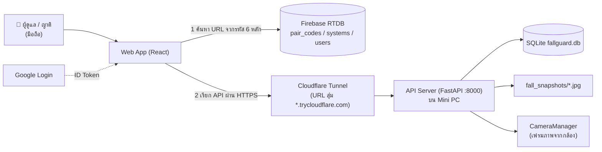

# 📱 เอกสารที่ 1 — ฝั่งเว็บ (Web App + API Server)

> **ระบบ:** เครื่องประมวลผลภาพอัจฉริยะเพื่อตรวจจับและแจ้งเตือนการล้มของผู้สูงอายุภายในบ้านด้วย AI ผ่านระบบไลน์ (Fall Guard)
> **ขอบเขตของเอกสารนี้:** เว็บแอปบนมือถือ (`web_app/`) และ API Server (`api_server/`) ที่เว็บเรียกใช้
> **ที่มาข้อมูล:** อ่านจากซอร์สโค้ดจริงในโปรเจกต์ (ทุกข้อเป็น FACT จากโค้ด เว้นแต่ระบุว่า *สมมติฐาน*)
> **เอกสารคู่กัน:** [เอกสาร_2_ฝั่ง_GUI.md](./เอกสาร_2_ฝั่ง_GUI.md)

---

## 1. ระบบฝั่งเว็บทำงานอย่างไร

### 1.1 ภาพรวมแบบสั้น

เว็บแอปคือ **หน้าจอดูกล้องและประวัติการล้มผ่านมือถือ** ตัวเว็บ **ไม่ได้ประมวลผล AI เอง** แต่ต่อเข้ากับเครื่อง Mini PC ที่บ้านผู้สูงอายุ (เรียกว่า *Edge Server*) ผ่านอินเทอร์เน็ต

| ส่วน | เทคโนโลยี | อยู่ที่ไหน |
|---|---|---|
| Web App (หน้าจอมือถือ) | React 19 + Vite, react-router, framer-motion, Google OAuth | โฮสต์บน Firebase Hosting (มี `firebase.json`) |
| ทะเบียนกลาง (Registry) | Firebase Realtime Database | คลาวด์ |
| API Server | FastAPI + SQLite + JWT | บน Mini PC (พอร์ต 8000) |
| ช่องทางเข้าจากภายนอก | Cloudflare Tunnel (`cloudflared_auto.py`) | บน Mini PC |

### 1.2 แผนภาพการทำงาน

### 1.3 ลำดับการใช้งานตั้งแต่ต้นจนดูภาพ

1. **เข้าสู่ระบบ** — ผู้ใช้กด Sign in with Google ที่หน้า `/login` ได้ Google credential เก็บไว้ใน `localStorage`
2. **จับคู่อุปกรณ์** (ครั้งแรก) — ผู้ใช้ตั้งชื่ออุปกรณ์ (เช่น "บ้านคุณยาย") + กรอกรหัส 6 หลักจากหน้าจอ Mini PC
   - เว็บถาม Firebase `pair_codes/{รหัส}` → ได้ `system_id`
   - เว็บถาม Firebase `systems/{system_id}` → ได้ URL Cloudflare ล่าสุดของเครื่อง
   - เว็บส่ง Google credential ไปที่ `POST /api/auth/google` ของเครื่องนั้น → ได้ JWT (อายุ 7 วัน)
   - เว็บส่งรหัสไป `POST /api/pair` → เครื่องบันทึกการจับคู่ใน SQLite
   - เว็บบันทึกอุปกรณ์ลง Firebase `users/{google_id}/devices/{system_id}`
3. **ดูภาพสด** — หน้า `/dashboard` ขอรายชื่อกล้อง `GET /api/cameras` แล้วแต่ละกล้องแสดงสตรีม MJPEG จาก `/api/stream/{ip}`
4. **ดูประวัติการล้ม** — หน้า `/history` เรียก `GET /api/fall-events` พร้อมตัวกรองวันที่ แล้วแสดงรูป snapshot จาก `/api/snapshots/{ไฟล์}`
5. **เข้าครั้งถัดไป** — เว็บอ่านรายการอุปกรณ์จาก Firebase และขอ JWT ใหม่ให้ทุกเครื่องอัตโนมัติ (รีเฟรชทุก 5 นาที เพราะ URL Cloudflare เปลี่ยนได้เมื่อเครื่องรีสตาร์ต)

### 1.4 ข้อมูลที่ฝั่งเว็บเกี่ยวข้อง

| ที่เก็บ | ข้อมูล |
|---|---|
| SQLite `users` | google_id, email, ชื่อ, รูปโปรไฟล์ |
| SQLite `pairings` | ผู้ใช้ ↔ system_id, รหัสจับคู่, สถานะ, เวลา |
| SQLite `fall_events` | IP/ชื่อกล้อง, ชื่อไฟล์ภาพ, เวลาที่ตรวจพบ |
| ไฟล์ `fall_snapshots/` | ภาพ JPEG ขณะล้ม (DB เก็บแค่ชื่อไฟล์) |
| Firebase `/pair_codes/{code}` | system_id ของเครื่อง |
| Firebase `/systems/{id}` | URL Cloudflare + สถานะออนไลน์ |
| Firebase `/users/{google_id}/devices` | รายการอุปกรณ์ที่ผู้ใช้จับคู่ไว้ |
| localStorage เบราว์เซอร์ | Google credential, อุปกรณ์ที่เลือกอยู่ |

---

## 2. ใครใช้งานระบบฝั่งเว็บ

ระบบมี **ผู้ใช้งานเพียงบทเดียว คือ "ผู้ดูแล"** ซึ่งทำได้ทุกอย่างทั้งฝั่งเว็บและฝั่ง GUI (โค้ดไม่มีการแยกสิทธิ์)

| ผู้ใช้ | สิ่งที่ทำบนเว็บ |
|---|---|
| **ผู้ดูแล** (ผู้ใช้เพียงบทเดียว) | Login, จับคู่เครื่อง (กรอกรหัสจากหน้าจอ Mini PC), ดูภาพสด, ดูประวัติการล้ม, เพิ่ม/สลับ/เปลี่ยนชื่อ/ลบอุปกรณ์ (ดูได้หลายบ้านหากมีหลายเครื่อง) |

**ผู้ถูกเฝ้าระวัง (ไม่ได้ใช้ระบบ):** ผู้สูงอายุและบุคคลภายในบ้าน

**บริการภายนอก (ไม่ใช่ผู้ใช้):** Google OAuth (ยืนยันตัวตน), Firebase (ทะเบียนกลาง), Cloudflare Tunnel (ช่องทางเข้า), LINE (ช่องทางแจ้งเตือน)

---

## 3. ฟังก์ชันการทำงานของฝั่งเว็บ (ทั้งหมด 9 ฟังก์ชัน)

| # | ฟังก์ชัน | ทำอะไร | หน้า / ไฟล์ที่เกี่ยวข้อง | API ที่ใช้ |
|---|---|---|---|---|
| **W1** | **เข้าสู่ระบบด้วย Google** | ยืนยันตัวตนด้วยบัญชี Google; มีโหมด Dev (`dev-mode`) สำหรับทดสอบ | `LoginPage`, `AuthContext` | `POST /api/auth/google` |
| **W2** | **จับคู่อุปกรณ์ด้วยรหัส 6 หลัก** | กรอกรหัส + ตั้งชื่ออุปกรณ์ → ค้นหาเครื่องผ่าน Firebase → จับคู่ | `PairPage`, `PairCodeInput` | `POST /api/pair` |
| **W3** | **ดูภาพกล้องสด (Live)** | แสดงสตรีมกล้องทุกตัวของเครื่องที่เลือก พร้อมป้าย LIVE และชื่อ/IP | `DashboardPage`, `CameraCard` | `GET /api/cameras`, `GET /api/stream/{ip}` |
| **W4** | **ดูประวัติการล้ม** | รายการเหตุการณ์พร้อมภาพ snapshot จัดกลุ่มตามวัน | `HistoryPage`, `FallEventCard` | `GET /api/fall-events`, `GET /api/snapshots/{file}` |
| **W5** | **กรองประวัติตามช่วงเวลา** | ตัวกรอง วันนี้ / เมื่อวาน / 7 วัน / ทั้งหมด | `HistoryPage` | `date_from`, `date_to` |
| **W6** | **จัดการหลายอุปกรณ์** | ดูรายการ, สลับเครื่องที่ดู, เปลี่ยนชื่อ, ลบเครื่อง | `DashboardPage`, `AuthContext` | `DELETE /api/pair` + Firebase |
| **W7** | **เชื่อมต่ออัตโนมัติ/รีเฟรช URL** | โหลดอุปกรณ์จาก Firebase เมื่อเข้าใหม่ และขอ token ใหม่ทุก 5 นาที | `AuthContext` | `GET /api/auth/me`, Firebase |
| **W8** | **ป้องกันหน้าและนำทาง** | หน้าที่ต้อง login ถูกป้องกัน; ถ้าไม่มีอุปกรณ์พาไป `/pair`; เมนูล่าง Dashboard/History | `ProtectedRoute`, `BottomNav`, `App` | — |
| **W9** | **ออกจากระบบ** | ล้าง credential และอุปกรณ์ที่เลือก (กดที่รูปโปรไฟล์) | `DashboardPage`, `AuthContext` | — |

### ฟังก์ชันฝั่ง API Server ที่รองรับเว็บ (Backend)

| Endpoint | หน้าที่ | ต้อง Login |
|---|---|---|
| `POST /api/auth/google` | ตรวจ Google token แล้วออก JWT 7 วัน | ไม่ |
| `GET /api/auth/me` | ข้อมูลผู้ใช้ปัจจุบัน | ใช่ |
| `GET /api/pair/current`, `/generate` | รหัสจับคู่ปัจจุบัน (แสดงบนจอ Mini PC) | ไม่ |
| `POST /api/pair`, `GET /api/pair/status`, `DELETE /api/pair` | จับคู่ / เช็คสถานะ / ยกเลิก | ใช่ |
| `GET /api/cameras`, `/api/frames`, `/api/frames/{ip}` | รายชื่อกล้อง / เฟรม base64 | ใช่ |
| `GET /api/stream/{ip}` | สตรีม MJPEG (~30 fps) | ไม่* |
| `GET /api/fall-events` | ประวัติการล้ม (limit, offset, camera, date) | ใช่ |
| `GET /api/snapshots/{file}` | ภาพ snapshot | ไม่* |
| `GET /api/status` | Health check | ไม่ |

\* เปิดโดยไม่ตรวจ token เพื่อให้แท็ก `` ใช้งานได้ ดูข้อสังเกตด้านล่าง

---

## 4. ข้อสังเกต / จุดที่ควรทราบ (จากการอ่านโค้ด)

| ระดับ | ข้อสังเกต |
|---|---|
| 🔴 สูง | `/api/stream/{ip}` และ `/api/snapshots/{file}` **ไม่ตรวจ JWT** — ใครได้ URL Cloudflare + IP กล้อง ก็ดูภาพได้ |
| 🔴 สูง | CORS เปิด `allow_origins=["*"]` (โค้ดมีคอมเมนต์ว่าควรจำกัดตอน production) |
| 🟠 กลาง | รหัสจับคู่เป็น **รหัสถาวร** ไม่หมดอายุ และไม่ถูกใช้แล้วทิ้ง → ใครรู้รหัส + มี Google account จับคู่ได้ |
| 🟠 กลาง | ไม่มีการตรวจว่าใครเป็นเจ้าของอุปกรณ์ — ผู้ใช้ Google คนใดก็ล็อกอินที่เครื่องได้ถ้ารู้ URL (โหมดจริงตรวจแค่ Google token) |
| 🟡 ต่ำ | `total` ใน `/api/fall-events` คือจำนวนในหน้านั้น ไม่ใช่จำนวนทั้งหมด |
| 🟡 ต่ำ | ประวัติบนเว็บ **มีเฉพาะเหตุการณ์ล้ม** — เหตุการณ์ผู้บุกรุกส่งแค่ LINE + เก็บภาพ ไม่เข้า DB จึงไม่ขึ้นหน้า History |
| 🟡 ต่ำ | ชื่อหัวข้อ Dashboard ยาวมาก (ใช้ชื่อโปรเจกต์เต็ม) อาจล้นบนจอมือถือ *(สมมติฐาน — ยังไม่ได้ทดสอบบนมือถือจริง)* |
| ℹ️ | URL Cloudflare เป็นแบบสุ่ม (TryCloudflare) เปลี่ยนทุกครั้งที่เครื่องรีสตาร์ต จึงต้องผ่าน Firebase |
