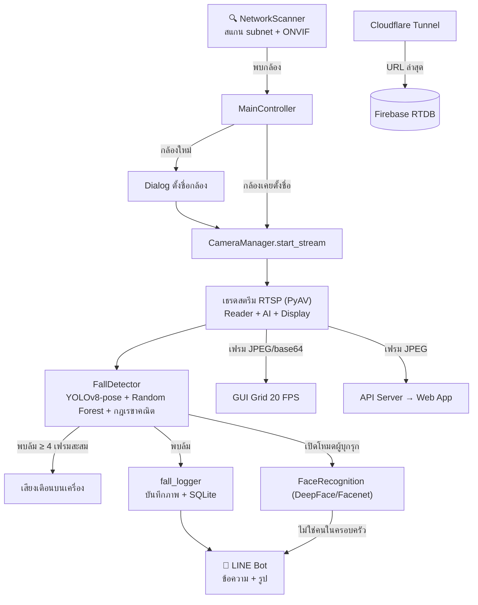

# 🖥️ เอกสารที่ 2 — ฝั่ง GUI (โปรแกรมควบคุมเครื่อง + ส่งข้อมูล)

> **ระบบ:** เครื่องประมวลผลภาพอัจฉริยะเพื่อตรวจจับและแจ้งเตือนการล้มของผู้สูงอายุภายในบ้านด้วย AI ผ่านระบบไลน์ (Fall Guard)
> **ขอบเขตของเอกสารนี้:** โปรแกรม Desktop บน Mini PC (`main.py`, `src/`, `detection.py`, `Tools/`) ซึ่งเป็น "สมอง" ของระบบ
> **ที่มาข้อมูล:** อ่านจากซอร์สโค้ดจริงในโปรเจกต์ (ทุกข้อเป็น FACT จากโค้ด เว้นแต่ระบุว่า *สมมติฐาน*)
> **เอกสารคู่กัน:** [เอกสาร_1_ฝั่งเว็บ.md](./เอกสาร_1_ฝั่งเว็บ.md)

---

## 1. ระบบฝั่ง GUI ทำงานอย่างไร

### 1.1 ภาพรวมแบบสั้น

เมื่อรัน `main.py` จะเปิด **3 ส่วนพร้อมกัน** บนเครื่องเดียว:

| ส่วน | ทำอะไร |
|---|---|
| **GUI (Flet)** | หน้าจอ "AI Security Center" แบบเต็มจอ — ควบคุมระบบ, ดูกล้อง, ตั้งค่า |
| **API Server (FastAPI :8000)** | เธรดเบื้องหลัง — ให้เว็บมือถือเรียกดูภาพ/ประวัติ (ดูเอกสารที่ 1) |
| **Cloudflare Tunnel** | เธรดเบื้องหลัง — เปิดช่องทางออกอินเทอร์เน็ต แล้วรายงาน URL ขึ้น Firebase |

GUI ใช้โครงสร้าง **MVC**: `MainView` (หน้าจอ) ↔ `MainController` (ตัวควบคุม) ↔ `CameraManager` / `NetworkScanner` (โมเดลข้อมูล)

### 1.2 แผนภาพการไหลของข้อมูล

### 1.3 ลำดับการทำงานตั้งแต่เปิดเครื่อง

1. รัน `main.py` → เริ่ม API Server, Cloudflare Tunnel และเปิดหน้าต่าง GUI เต็มจอ
2. สร้าง/โหลด **System ID** และ **รหัสจับคู่ 6 หลัก** (เก็บใน `config/system_config.json`) แล้วส่งรหัสขึ้น Firebase
3. ถ้ายังไม่มีใครจับคู่ → แสดงแบนเนอร์รหัสสีเหลืองบนหน้าจอ
4. **สแกนเครือข่ายอัตโนมัติ** หากล้อง (ตรวจพอร์ตทั่วไปทุก IP ใน subnet → เชื่อม ONVIF ด้วย user/password ที่ตั้งไว้ → ได้ RTSP URL + serial number)
5. พบกล้องใหม่ → เด้งถามชื่อกล้อง (พร้อมภาพตัวอย่าง) → เริ่มสตรีม; กล้องเคยบันทึกชื่อไว้ → เริ่มสตรีมทันที
6. ต่อกล้องแต่ละตัวด้วย 3 เธรด: **อ่านเฟรม** / **วิเคราะห์ AI (~12 ครั้ง/วินาที)** / **แสดงผล (~30 fps, 960×540)**
7. AI ประเมินท่าทางของทุกคนในภาพ ถ้าเข้าเงื่อนไขล้มสะสมครบ → ส่งเสียงเตือน + บันทึกเหตุการณ์ + ส่ง LINE (กันซ้ำภายใน 30 วินาทีต่อกล้อง)
8. ถ้ากล้องหลุด → ลองเชื่อมต่อใหม่สูงสุด 10 ครั้ง (หน่วงเวลาเพิ่มทีละขั้น)

### 1.4 AI ตรวจจับการล้มทำงานอย่างไร

| ชั้น | วิธี | รายละเอียดที่ยืนยันจากโค้ด |
|---|---|---|
| 1 | **YOLOv8n-pose** | หา "โครงกระดูก 17 จุด" ของทุกคนในภาพ (`conf ≥ 0.45`) |
| 2 | **Random Forest (multipose_model.pkl)** | จัดท่าเป็น 5 ท่า: เดิน / ยืน / นั่ง / ก้ม / ล้ม (34 ฟีเจอร์ จากจุดกระดูก) |
| 3 | **กฎเรขาคณิต** | นอนราบบนพื้น, หัวต่ำกว่าสะโพก, ลำตัวเอียง > 55°, AI มั่นใจว่าล้ม > 45% |
| 4 | **กันการเตือนผิด** | ภาพใกล้ใบหน้า/ท่อนบนไม่นับเป็นล้ม; ต้องล้ม **สะสม ≥ 4 เฟรม** จึงเตือน; ตัวนับลดลงช้าๆ เมื่อคนบังชั่วคราว |

**ความแม่นยำโมเดล Random Forest** (จาก `Tools/pose_labels.json`): ทดสอบ **78.9%**, Cross-validation เฉลี่ย **80.0%** (ข้อมูล 5,640 ตัวอย่าง, 1,128 ตัวอย่างต่อท่า) — *ค่านี้เป็นความแม่นยำการจัดท่า 5 ประเภท ไม่ใช่ความแม่นยำการตรวจจับล้มจริงตลอดระบบ ซึ่งในโปรเจกต์ยังไม่พบผลทดสอบเชิงระบบ*

---

## 2. ใครใช้งานระบบฝั่ง GUI

ระบบมี **ผู้ใช้งานเพียงบทเดียว คือ "ผู้ดูแล"** ซึ่งทำได้ทุกอย่างบน GUI (โค้ดไม่มีการแยกสิทธิ์)

| ผู้ใช้ | ใช้ GUI ทำอะไร |
|---|---|
| **ผู้ดูแล** (ผู้ใช้เพียงบทเดียว) | ใส่ user/password กล้อง, ตั้ง LINE, ตั้งชื่อกล้อง, ดูภาพรวมกล้อง, เปิด/ปิดโหมดผู้บุกรุก, ลงทะเบียนใบหน้าสมาชิก, ดูรหัสจับคู่ |

**ผู้ถูกเฝ้าระวัง (ไม่ได้ใช้ระบบ):**
- **ผู้สูงอายุ** — ถูกตรวจจับท่าทางโดยอัตโนมัติ
- **บุคคลภายในบ้าน** — ถูกตรวจจับท่าทางเช่นกัน และถ้าผู้ดูแลลงทะเบียนใบหน้าไว้ ระบบจะรู้ว่า "ไม่ใช่ผู้บุกรุก"

**ช่องทางรับผลลัพธ์ (ไม่ใช่ผู้ใช้):** กลุ่ม LINE ที่ผู้ดูแลตั้งไว้ รับข้อความ + ภาพเมื่อล้ม/พบผู้บุกรุก

> งานฝึกโมเดล (`Tools/prepare_dataset.py`, `train_multipose.py`) เป็นงานพัฒนา ไม่ใช่การใช้งานระบบประจำวัน

---

## 3. ฟังก์ชันการทำงานของฝั่ง GUI (ทั้งหมด 12 ฟังก์ชัน)

| # | ฟังก์ชัน | ทำอะไร | ไฟล์หลัก |
|---|---|---|---|
| **G1** | **ค้นหากล้องอัตโนมัติ (Radar Scanning)** | สแกนทุก IP ใน subnet ของเครื่อง ตรวจพอร์ตกล้อง → ต่อ ONVIF → ดึง RTSP + serial number; สแกนซ้ำเป็นรอบ | `network_scanner.py` |
| **G2** | **ตั้งชื่อ / เปลี่ยนชื่อกล้อง** | กล้องใหม่ขึ้น Dialog พร้อมภาพตัวอย่าง; กดปุ่มแก้ไขที่การ์ดเพื่อเปลี่ยนชื่อ; บันทึกใน `config/cameras.json` (ผูกกับ serial number จึงจำได้แม้ IP เปลี่ยน) | `main_controller.py`, `camera_manager.py` |
| **G3** | **แสดงภาพกล้องทุกตัวแบบตาราง** | แสดงกริดกล้อง ~20 FPS พร้อมกรอบสถานะ AI; กล้องหลุดแสดง "กำลังเชื่อมต่อใหม่..." | `main_view.py` |
| **G4** | **ตรวจจับการล้มด้วย AI** | YOLOv8-pose + Random Forest + กฎเรขาคณิต รองรับหลายคนในภาพ แยกสถานะรายกล้อง | `detection.py` |
| **G5** | **แจ้งเตือนด้วยเสียงบนเครื่อง** | เล่นเสียงเตือนเมื่อพบล้ม/ผู้บุกรุก (หน่วง 10 วินาทีต่อครั้ง) | `detection.py` |
| **G6** | **บันทึกเหตุการณ์ล้ม** | เซฟภาพ snapshot (วาดกรอบ/ป้ายบนภาพ) + บันทึก SQLite; กันซ้ำ 30 วินาที/กล้อง | `fall_logger.py` |
| **G7** | **แจ้งเตือนผ่าน LINE** | ส่งข้อความ "🚨 แจ้งเตือนการล้ม! กล้อง/เวลา" เข้ากลุ่ม LINE พร้อมแนบรูป (รูปแนบได้เมื่อมี URL HTTPS จาก Cloudflare) | `fall_logger.py` |
| **G8** | **ลงทะเบียนใบหน้าสมาชิก (Register Family)** | เปิดเว็บแคม ถ่ายหลายมุมหน้า + ชื่อ/เบอร์/เพศ → สกัด embedding ด้วย Facenet เก็บใน `config/faces/` | `face_recognition_service.py` |
| **G9** | **ตรวจจับผู้บุกรุก (Intruder Detection)** | สวิตช์เปิด/ปิดบนหน้าจอ (ค่าเริ่มต้น **ปิด**); เทียบใบหน้ากับคนที่ลงทะเบียน (cosine < 0.48 = คนรู้จัก); ใบหน้าไม่ตรงหรือปิดหน้าเกิน 4 วินาที = ผู้บุกรุก → เสียงเตือน + LINE | `detection.py`, `face_recognition_service.py` |
| **G10** | **ตั้งค่าระบบ** | ปุ่มเฟือง: ใส่ Username/Password ของกล้อง + LINE Bot Token + LINE Group ID (เก็บใน `config/config.json`) | `main_controller.py`, `main_view.py` |
| **G11** | **แสดงรหัสจับคู่ (Pairing Code)** | แสดงรหัส 6 หลักแบนเนอร์เหลืองเมื่อยังไม่มีใครจับคู่; ปุ่ม QR เรียกรหัสกลับมาดูได้; ตรวจสถานะจับคู่ทุก ~10 วินาที | `pairing.py`, `main_controller.py` |
| **G12** | **ส่งข้อมูลออกสู่เว็บ (Tunnel + Firebase + API)** | เปิด Cloudflare Tunnel ได้ URL สาธารณะ → อัปเดตขึ้น Firebase; เปิด API ให้เว็บดึงภาพ/ประวัติ | `cloudflared_auto.py`, `api_server/` |

### ฟังก์ชันสนับสนุน (ทำงานเบื้องหลัง ไม่มีปุ่ม)

| ฟังก์ชัน | รายละเอียด |
|---|---|
| ต่อสตรีมอัตโนมัติ | ลองหลาย URL (ONVIF, `/onvif1`, `/onvif2`, `/live/ch0` ฯลฯ) และหลายโหมด (Auto/TCP/UDP) |
| เชื่อมต่อใหม่เมื่อหลุด | สูงสุด 10 ครั้ง, หน่วงเพิ่มทีละขั้น (สูงสุด 10 วินาที) |
| กล้องคู่ (Dual camera) | แยกภาพจากกล้องที่มี 2 เลนส์เป็น 2 ช่องแล้วตรวจแยกกัน (ตั้งค่าใน `cameras.json` — *รายละเอียดการตั้งค่าอยู่ใน `frame_splitter.py` ยังไม่ได้ตรวจเชิงลึก*) |
| ฟื้นสถานะเมื่อ GUI เชื่อมต่อใหม่ | ถ้า session ของ Flet หลุด จะกู้ CameraManager/Scanner เดิมกลับมา ไม่ต้องสแกนใหม่ |
| เข้ารหัส JPEG เร็ว | ใช้ TurboJPEG ถ้ามี ไม่งั้นใช้ OpenCV |

---

## 4. ข้อสังเกต / จุดที่ควรทราบ (จากการอ่านโค้ด)

| ระดับ | ข้อสังเกต |
|---|---|
| 🔴 สูง | `config/config.json` เก็บ **รหัสผ่านกล้อง และ LINE Bot Token เป็นข้อความธรรมดา** — ควรตรวจว่าไม่ถูก commit ขึ้น Git (`.gitignore` ควรมีรายการนี้) และพิจารณาเปลี่ยน token หากเคยหลุด |
| 🟠 กลาง | ปิดโหมดผู้บุกรุกทุกครั้งที่เปิดโปรแกรม (ตั้ง `INTRUDER_DETECTION=0` ตอนเริ่ม) — ต้องเปิดสวิตช์เองทุกรอบ |
| 🟠 กลาง | เหตุการณ์ผู้บุกรุกส่งผ่าน LINE + เก็บไฟล์ภาพ แต่ **ไม่บันทึกลง DB** จึงไม่มีประวัติให้ดูบนเว็บ |
| 🟠 กลาง | ภาพแนบ LINE ต้องใช้ URL Cloudflare แบบ HTTPS — ถ้า Tunnel ยังไม่พร้อม จะส่งเฉพาะข้อความ |
| 🟡 ต่ำ | ความแม่นยำที่มีหลักฐานคือการจัดท่า ~79–80%; ยังไม่พบรายงานความแม่นยำ/ความผิดพลาด (false alarm) ของการตรวจล้มทั้งระบบ — ควรทดสอบกับสถานการณ์จริง |
| 🟡 ต่ำ | ตรวจใบหน้าด้วยเกณฑ์ cosine 0.48 และ detector แบบ `opencv` — อาจพลาดเมื่อแสงน้อยหรือใส่หมวก/หน้ากาก (โค้ดมีกลไก "Masked" รองรับบางส่วน) |
| ℹ️ | โมเดลเก่า `fall_detect_model.pkl` (71 MB) ยังอยู่ใน `Tools/` แต่ระบบใช้ `multipose_model.pkl` |
